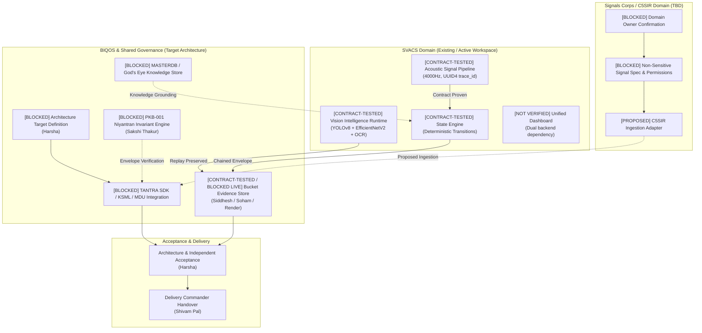
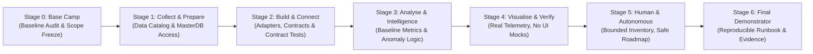
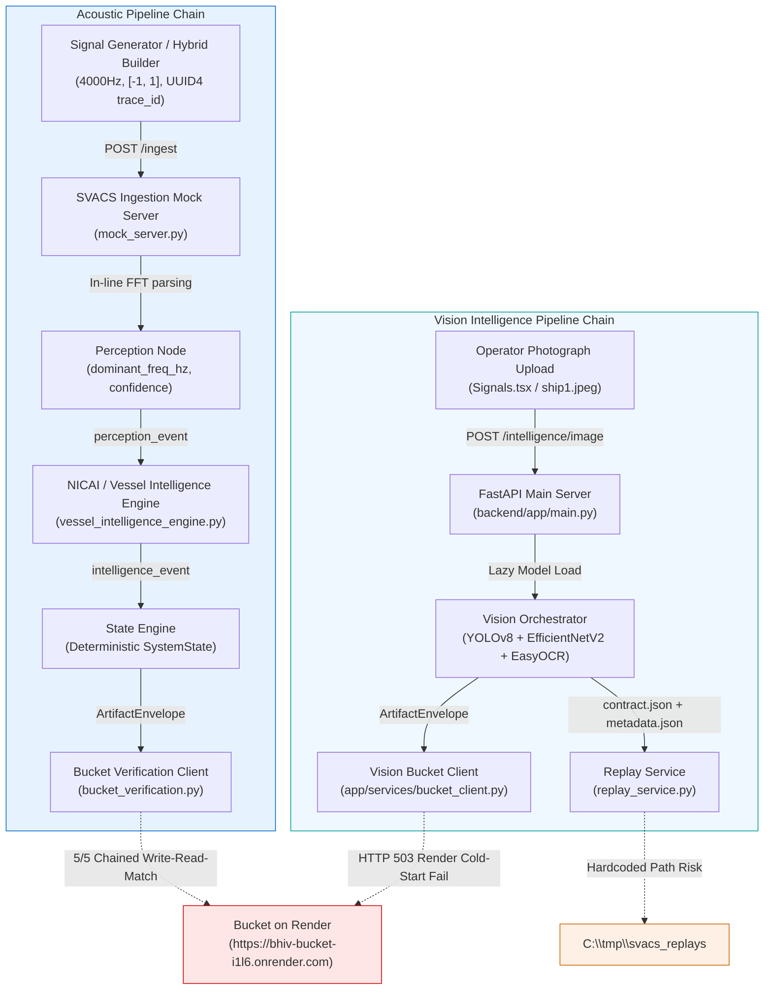
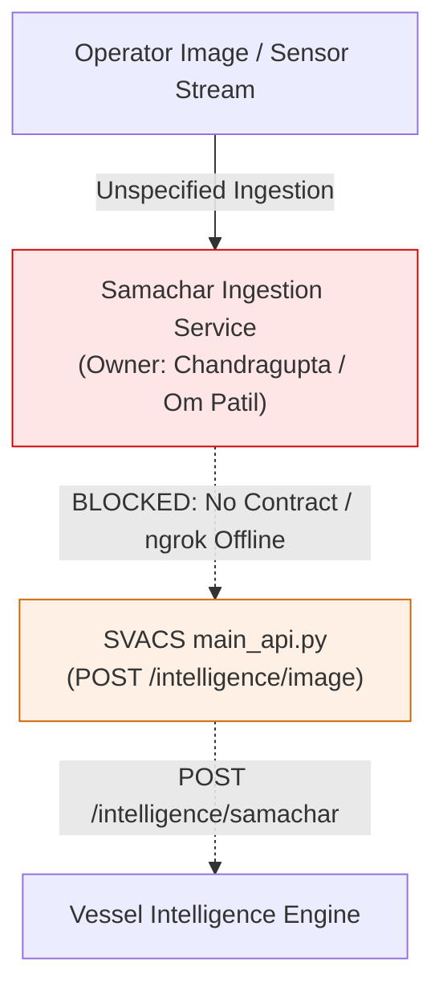
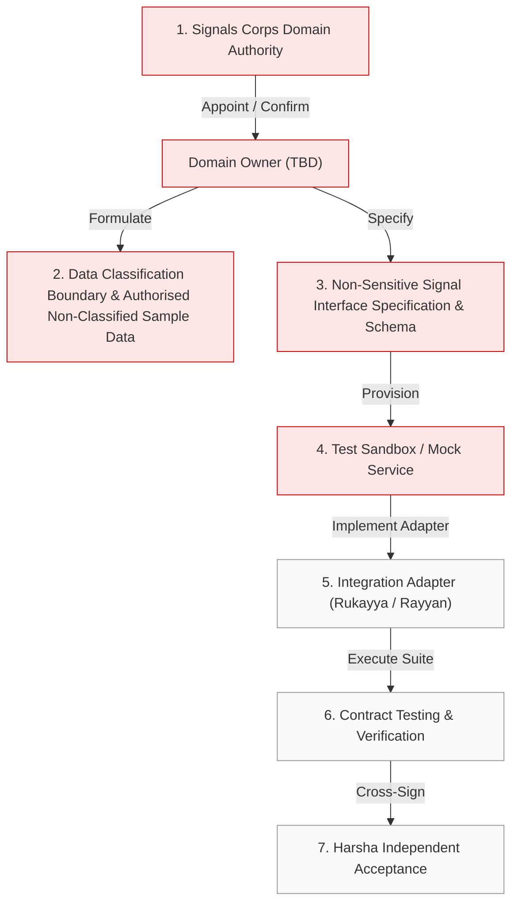
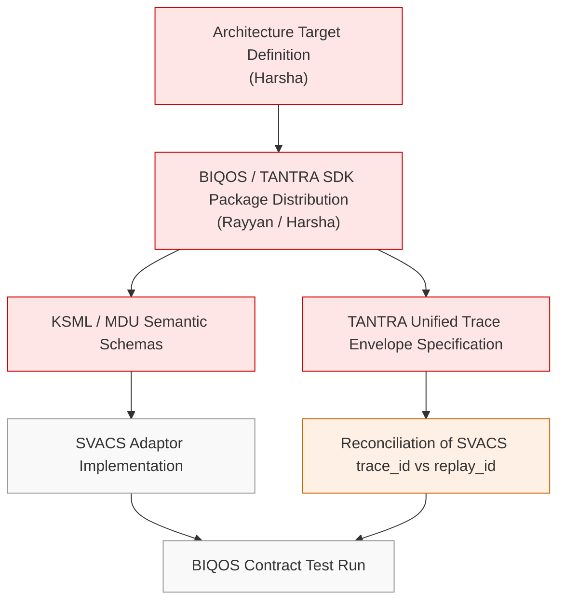
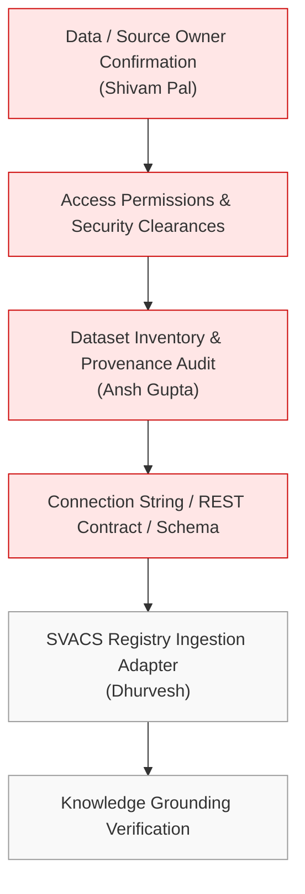
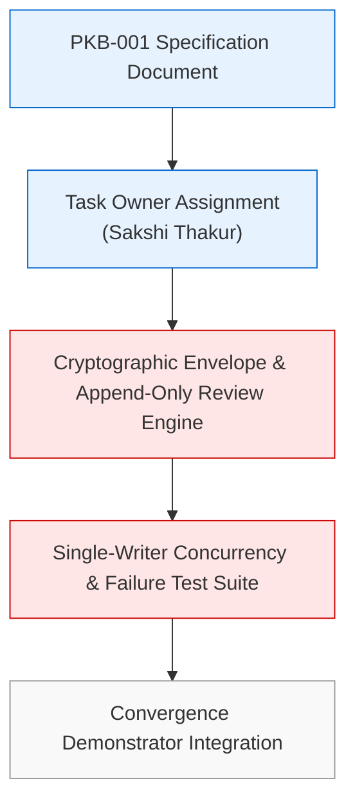

# BHIV × SEVA Defence Convergence Quest — Integration Dependency Graph

**Work Package:** Integration Coordination  
**Lead / Owner:** Rukayya Ansari  
**Date of Audit:** November 04, 2026  
**Audited Target Workspace:** `c:\Users\rukka\OneDrive\Desktop\Rukayya\bhiv-SVACS-main`  
**Governing Directive:** `BHIV_SEVA_Defence_Convergence_Quest_Individual_Tasks.pdf`

---

## 1. Executive Summary & Purpose

This document maps the complete technical and operational dependency network for the **BHIV × SEVA Defence Convergence Quest**. It establishes the prerequisite chain across SVACS, Signals Corps/C5SIR, and BIQOS, distinguishing **contract-tested existing implementations** from **unverified runtime configurations** and **proposed/blocked integrations**.

Under the quest execution rule, *"The quest image is the journey map, not proof that every depicted capability is already integrated."* Each node and dependency edge in this graph is grounded strictly in demonstrable code, schema definitions, historical test logs, or formal assignment briefs. Unconfirmed items are explicitly marked as `[PROPOSED]` or `[BLOCKED]`.

---

## 2. High-Level System Architecture & Boundary

The target convergence architecture integrates three primary domains through a shared governance layer:
1. **SVACS Domain**: Maritime vessel intelligence, acoustic signature classification, vision runtime (YOLOv8 + EfficientNetV2 + EasyOCR), and operator dashboard.
2. **Signals Corps / C5SIR Domain**: Signal intelligence, tactical communications, network telemetry, and infrastructure surveillance data.
3. **BIQOS Convergence Layer**: Shared governance, TANTRA SDK discovery/traceability, KSML/MDU semantic models, MasterDB knowledge retrieval, and Bucket chained evidence persistence.

---

## 3. End-to-End Dependency Flow & Gating Stages

The quest progresses through six sequential gates (Stages 0 to 6). Progress through each gate requires explicit evidence.

---

## 4. Detailed Component Dependency Chains

### 4.1 Chain A: SVACS Internal Signal & Vision Pipeline
*Status: CONTRACT-TESTED (Partial Verification)*

#### Prerequisite & Dependency Breakdown for Chain A:
1. **Acoustic Ingestion**: Requires `mock_server.py` running on port 8000. Verified via `trace_test.py` (10/10 PASS) and `test_failures.py` (6/6 PASS).
2. **Acoustic Perception → Intelligence**: Requires `vessel_intelligence_engine.py` rule definitions. Verified via `phase2_integration_results.json` (5/5 PASS) and `noisy_scenario_log.jsonl` (12/12 PASS).
3. **State Engine**: Requires valid UUID4 `trace_id` and strict `RiskLevel` enums. Verified via `schemas/state_event.py` and `5_trace_cases.json`.
4. **Vision Ingestion**: Direct upload from frontend works locally; bypassed Samachar ingestion.
5. **Vision Classification**: Requires weights `efficientnet_vessel_best.pth` (present in `backend/`, committed with Git LFS). Verified in `TESTING_PACKET.md` with real photographs.
6. **Vision Replay**: Requires disk write permission at `C:\tmp\svacs_replays`. Persistent across requests.
7. **Bucket Persistence**:
   - Acoustic path: Succeeded in May 2026 logs (5/5).
   - Vision path: Attempted twice in August 2026; both returned HTTP 503 (Render cold-start). **Unresolved technical dependency.**

---

### 4.2 Chain B: Samachar Ingestion & Forwarding
*Status: BLOCKED [PROPOSED]*

#### Dependency Breakdown for Chain B:
1. **Contract Definition**: Missing official OpenAPI/JSON schema from Chandragupta.
2. **Service Endpoint**: Historical endpoint (`https://c6e7-2409-40c2-1048-4c4f-d40e-1f12-f5dd-755a.ngrok-free.app`) is offline.
3. **Current Workaround**: Frontend `Signals.tsx` connects directly to SVACS `/intelligence/image?quick=true`, bypassing Samachar entirely.
4. **Resolution Required**: Chandragupta must provide stable endpoint, contract schema, and authentication credentials.

---

### 4.3 Chain C: Signals Corps / C5SIR Domain Integration
*Status: BLOCKED [PROPOSED]*

#### Dependency Breakdown for Chain C:
- **Prerequisite 1**: Domain owner must be formally named by Signals Corps/C5SIR team.
- **Prerequisite 2**: Delivery lead (Shivam) and Architecture lead (Harsha) must freeze the non-classified boundary and sample data.
- **Prerequisite 3**: Technical schema (frequency, bandwidth, framing, headers, timestamps, trace correlation) must be documented.
- **Current State**: Zero files, endpoints, or schemas exist in the workspace. All dependencies remain upstream of Step 1.

---

### 4.4 Chain D: BIQOS Shared Governance & TANTRA SDK Convergence
*Status: BLOCKED [PROPOSED]*

#### Dependency Breakdown for Chain D:
1. **Architecture Blueprint**: Harsha must confirm whether BIQOS operates as an orchestration gateway, a common middleware broker, or an SDK library.
2. **SDK Dependencies**: Neither `requirements.txt` nor `package.json` contains references to TANTRA SDK, KSML, or MDU libraries.
3. **Trace Identifier Reconciliation**:
   - In `backend/app/main.py`: `trace_id` is generated at the HTTP layer, but `vision_orchestrator.py` generates `replay_id`.
   - In acoustic pipeline: `trace_id` is uniform.
   - Downstream integration requires unifying this to a single canonical trace ID across all pipelines.

---

### 4.5 Chain E: MASTERDB / God's Eye Knowledge Grounding
*Status: BLOCKED [PROPOSED]*

#### Dependency Breakdown for Chain E:
- **Brief Rule**: *"Include MasterDB/God's Eye View only after access and content are verified. Availability must be confirmed, not inferred from product names."*
- **Current State**: No connection parameters, database driver, API client, or query scripts exist in the repository.

---

### 4.6 Chain F: PKB-001 Niyantran Invariant Verification
*Status: BLOCKED [PROPOSED]*

#### Dependency Breakdown for Chain F:
- **Task Brief**: Assigned to Sakshi Thakur (Task Card E).
- **Core Invariants Required**: Append-only review decision events, single-writer concurrency protection, cryptographic envelope validation.
- **Current State**: No PKB implementation exists in `bhiv-SVACS-main`. The specification alone is not implementation proof.

---

## 5. Prerequisite Matrix for Convergence Milestone

| Integration Item | Technical Prerequisite | Organizational Owner | Prerequisite Status | Impact if Unresolved |
|---|---|---|---|---|
| **C5SIR Ingestion** | Domain owner nomination & sample data contract | Signals Corps Domain Lead / Harsha | **BLOCKED** | Joint multi-domain convergence cannot be demonstrated; scope collapses to maritime only |
| **Samachar Ingestion** | Ingestion OpenAPI spec & active service URL | Chandragupta / Om Patil | **BLOCKED** | Demonstrator must use local direct upload; breaks end-to-end intelligence ingest narrative |
| **Bucket Evidence** | Dedicated/warm container deployment or keep-alive daemon | Rayyan (DevOps) / Siddhesh Narkar | **BLOCKED LIVE** | Image classification cannot guarantee tamper-proof audit chain; live calls fail with HTTP 503 |
| **BIQOS / TANTRA SDK** | Architecture boundary definition & SDK client distribution | Harsha / Rayyan | **BLOCKED** | Systems remain loosely coupled point-to-point services rather than a governed platform |
| **MasterDB Grounding** | Database host, credentials, and data license clearance | Shivam Pal / Ansh Gupta | **BLOCKED** | Demonstrator must rely exclusively on local static JSON registries (`vessel_registry.json`) |
| **Trace ID Unification** | Reconciliation of `trace_id` vs `replay_id` in `backend/app/main.py` | Ankita / Harsha | **OPEN DECISION** | Downstream consumers (Bucket/TANTRA) receive inconsistent correlation identifiers |
| **Replay Storage Portability**| Make `REPLAY_STORAGE_DIR` relative or environment-configurable | Rayyan / Vijay Dhawan | **OPEN DECISION** | System fails on fresh deployment without pre-existing `C:\tmp\svacs_replays` directory |
| **Backend API Consolidation** | Merge `frontend/services/api/main_api.py` and `backend/app/main.py` | Rayyan / Harsha | **OPEN DECISION** | Dashboard non-image pages render empty arrays when pointing to vision backend |

---

## 6. Critical Path to Minimum Viable Demonstrator

To deliver a working, evidence-backed demonstrator within the first 72 hours per the Quest Brief:

1. **Step 1 (Hours 0–4)**: Freeze primary use case with Shivam Pal and Harsha. Freeze decision to use **SVACS Maritime Component Traceability & Surveillance** with non-military commercial vessel analogues and synthetic acoustic signatures.
2. **Step 2 (Hours 4–24)**: Rayyan to resolve local Bucket service deployment (e.g. running Bucket locally via Docker or standing server) to eliminate Render 503 cold starts.
3. **Step 3 (Hours 24–48)**: Unify `trace_id` and `replay_id` in `backend/app/main.py` so that image uploads produce an unbroken, single-ID evidence chain into local Bucket storage.
4. **Step 4 (Hours 48–72)**: Clearly label C5SIR and BIQOS integrations as **PROPOSED / ROADMAP ARCHITECTURE** in the acceptance scorecard, preventing unverified or fraudulent integration claims.

